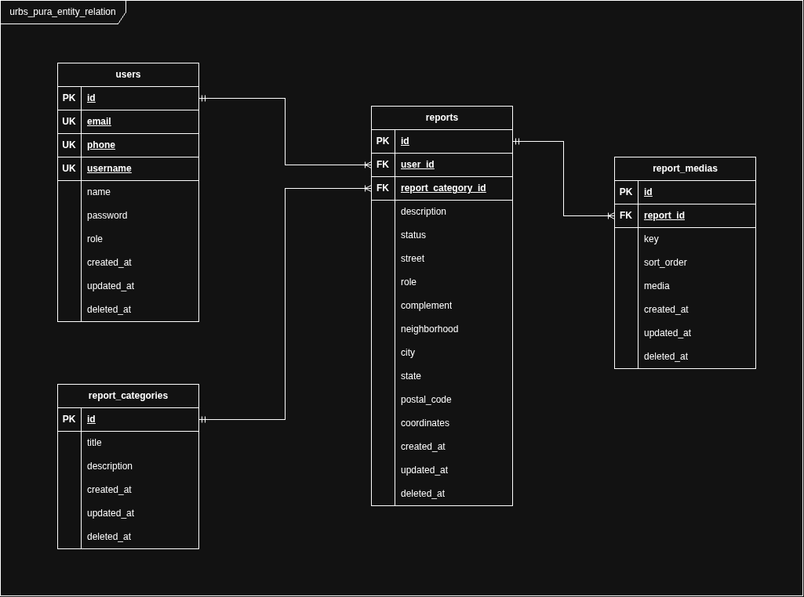

# Urbs Pura

O Urbs Pura é um projeto acadêmico desenvolvido como trabalho universitário. O sistema tem como objetivo permitir o registro e o gerenciamento de denúncias relacionadas a problemas urbanos, facilitando seu acompanhamento e organização.

## Estrutura do Projeto

O projeto possui uma API responsável pelas regras de negócio, comunicação com o banco de dados e gerenciamento de mídias.

```text
urbs_pura/
├── api/
│   ├── bin/
│   ├── lib/
│   │   ├── handlers/
│   │   ├── interfaces/
│   │   ├── models/
│   │   ├── repositories/
│   │   └── services/
│   └── pubspec.yaml
├── docker-compose.yml
├── docker-compose.dev.yml
├── docker-compose.prod.yml
├── urbs_pura_entity_relation.png
└── README.md
```

## Arquitetura do Sistema

### Diagrama Entidade-Relacionamento

O diagrama abaixo representa a estrutura do banco de dados e os relacionamentos entre suas entidades.



## Tecnologias Utilizadas

- Dart
- Shelf
- PostgreSQL
- PostGIS
- SeaweedFS
- Docker
- Docker Compose

## Funcionalidades

- Autenticação e autorização de usuários.
- Gerenciamento de usuários.
- Gerenciamento de categorias de denúncias.
- Criação e gerenciamento de denúncias.
- Armazenamento de coordenadas geográficas.
- Envio e consulta de imagens.
- Associação de mídias às denúncias.

## Variáveis de Ambiente

Configure as variáveis de ambiente necessárias para a API e para os serviços da infraestrutura.

Exemplo das variáveis relacionadas ao armazenamento:

```env
DART_ENV=

DATABASE_PORT=
DATABASE_HOST=
DATABASE_NAME=
DATABASE_USER=
DATABASE_PASSWORD=
DATABASE_URL=

SERVER_PORT=
SERVER_JWT_SECRET=
SERVER_JWT_ACCESS_TOKEN_EXPIRATION=
SERVER_JWT_REFRESH_TOKEN_EXPIRATION=

S3_ENDPOINT=
S3_ACCESS_KEY=
S3_SECRET_KEY=
S3_BUCKET=
S3_REGION=
```

## Executando o Projeto

Certifique-se de que o Docker e o Docker Compose estejam instalados.

Para iniciar o ambiente de desenvolvimento:

```bash
docker compose \
-f docker-compose.yml \
-f docker-compose.dev.yml \
--env-file .env.dev \
watch
```

Para visualizar os logs do ambiente de desenvolvimento:

```bash
docker compose \
-f docker-compose.yml \
-f docker-compose.dev.yml \
--env-file .env.dev \
logs -f
```

Para encerrar os containers:

```bash
docker compose down
```

## Objetivos do Projeto

- Aplicar conceitos de engenharia de software em um projeto prático.
- Desenvolver uma API REST utilizando Dart.
- Trabalhar com bancos de dados relacionais e geoespaciais.
- Implementar autenticação e autorização.
- Integrar armazenamento de objetos para arquivos de mídia.
- Praticar conteinerização e orquestração de serviços.

## Licença

Projeto acadêmico desenvolvido para fins educacionais.
